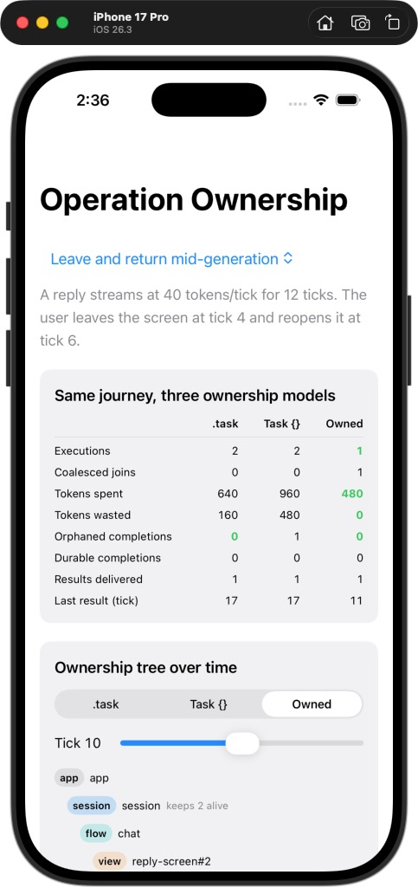
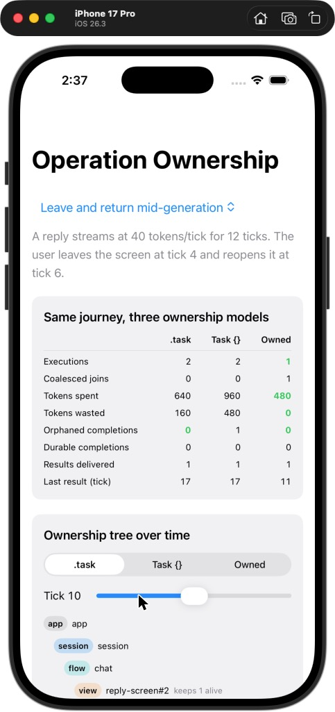
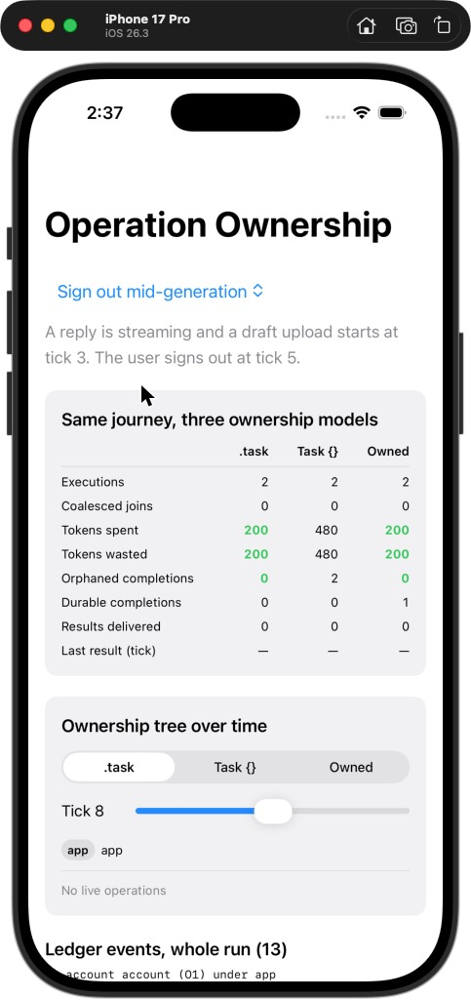

# Operation Ownership — Demo App

**Same user journey, three ownership models, real numbers.** This iOS app runs the
[`OperationOwnership`](https://github.com/rajatslakhina/operation-ownership-kit) ledger through four scripted journeys:

- leave and return mid-generation;
- sign out mid-stream;
- three rows asking for one summary;
- search-as-you-type.

Each journey runs under three ownership models, side by side:

- `.task`-bound;
- fire-and-forget `Task {}`;
- **owned**, where every piece of work declares its intent, owner, resource and lifetime.

## Why this matters

When a reply vanishes because the user tapped Back, or a stream keeps billing after sign-out, the cause is the same: the work's lifetime was tied to whatever was closest at hand. This app makes that cost visible. The library makes the fix a shared platform rule instead of a per-feature habit.

## What you see

1. **Scenario picker.** The default is *Leave and return mid-generation*.
2. **Comparison card.** For each model it shows executions, coalesced joins, tokens spent and wasted, orphaned and durable completions, results delivered, and the tick the last result arrived. The best value in each "lower is better" row is highlighted. Every number comes from the real `OwnershipLedger`, driven in virtual time by `OwnershipLab`.
3. **Ownership tree over time.** Pick a model and scrub the tick slider. You see owners open and close, and operations go `queued → running → draining`. Each claim shows who is waiting for the value (◉ awaiting / ○ detached) and which owner keeps it alive.
4. **Ledger events.** The whole run's ordered event log.

The app owns one scenario itself, *Search as you type*. It is declared in `Demo/DemoApp.swift` with the library's core types (`LabScenario`, `LabRequest`, `Lane`, `LaneLimits`), because a lane and a "latest query wins" rule are product decisions. The scenario shows the trade-off honestly:

| | `.task` | `Task {}` | Owned (`.replace`) |
|---|---:|---:|---:|
| Executions started | 4 | 4 | 4 |
| Tokens spent | 120 | 120 | **40** |
| Tokens wasted | 0 | 0 | 10 |
| Results delivered | 4 (three stale) | 4 (three stale) | 1 (the latest) |
| Last result at tick | 5 | 5 | 6 |

Owned work supersedes three queries. Each of them started, as the query before it drained, and was then superseded. Only the first had consumed anything before it was superseded, so 10 tokens are wasted. In exchange it spends a third as much in total and never shows a stale result. The cost is one tick of latency: the latest query waits for the superseded task to drain, because the library never lets two tasks work on one resource at once.

## Screenshots

These are real captures of this app running on the **iPhone 17 Pro Simulator (iOS 26.3)**. It was built and launched from `Demo.xcodeproj` in Xcode 26.3 on 22 Oct 2026, with `operation-ownership-kit` resolved from GitHub at **1.0.0**. The captures are of the Simulator window, so they are low resolution.

<p>



</p>

1. **Default state.** *Leave and return mid-generation*, Owned strategy, tick 10. The session "keeps 2 alive": a detached claim from the closed screen and an awaiting claim from the returning one.
2. **`.task` at the same tick.** The returning screen keeps its own restarted stream alive ("keeps 1 alive"). The first stream was already cancelled and its 160 tokens sunk.
3. **Sign out mid-generation.** `Task {}` orphans both completions (480 tokens wasted). Owned ends the stream but lands the must-finish upload (durable 1).

During the run, the strategy segment and the scenario picker were tapped, and each change updated the card and the tree.

## How to run it

1. `git clone https://github.com/rajatslakhina/operation-ownership-demo-app.git`
2. Open `Demo.xcodeproj` in Xcode 16 or later. Xcode resolves `operation-ownership-kit` from GitHub. It is a remote Swift package with a **version range: up to next major from 1.0.0**. It is not a local path and not a branch. No `Package.resolved` is committed, so a fresh clone resolves the newest 1.x tag.
3. Select the **Demo** scheme and an iOS 17+ Simulator.
4. Build & Run (⌘R).

## Design decisions

| Decision | Chosen | Rejected, and why |
|---|---|---|
| Where the app lives | A separate repository consuming the library as a remote package | An example target inside the library repo: an SPM executable target doesn't produce a real, stable `.app` bundle, and keeping the app outside proves the public API is enough on its own |
| Dependency requirement | Version range from the `v1.0.0` tag (`upToNextMajorVersion`) | `branch = main` resolves whatever `main` is that day. A local path never proves the package resolves from GitHub at all |
| Committing `Package.resolved` | Not committed | Committing it gives byte-for-byte reproducible builds, but then the demo would stop picking up 1.x patch fixes. For a demo whose job is to track the library, the range is the right default; an app shipping to users should commit it |
| What the UI drives | The real ledger in **virtual time** (`OwnershipLab`) | Live `Task`s with sleeps: timing-dependent, different on every run, and impossible to compare side by side. Virtual time makes every number reproducible and lets the tests pin them |
| Where the 4th scenario lives | In the app (`DemoScenarios`) | As a library preset: lane names and "latest query wins" are product decisions, and declaring the scenario here exercises the public core API from outside the module |

## Project layout

```
Demo.xcodeproj/                       # XCRemoteSwiftPackageReference → operation-ownership-kit.git (from 1.0.0)
  xcshareddata/xcschemes/Demo.xcscheme
Demo/DemoApp.swift                    # @main App; owns the app-specific scenario catalogue
.github/workflows/ci.yml              # macOS 15: resolve the remote package, build for generic iOS Simulator
```

## Verification

- **Ran on a Simulator:** yes, once, as described under Screenshots. Xcode 26.3 resolved `operation-ownership-kit` 1.0.0 from GitHub, built the app, installed it on the iPhone 17 Pro Simulator (iOS 26.3) and launched it. The scenario picker and the strategy control were exercised, and the app did not crash.
- **CI** ([Actions tab](https://github.com/rajatslakhina/operation-ownership-demo-app/actions)): green. The macOS 15 job selects Xcode 16.4 and runs `xcodebuild -resolvePackageDependencies`, which resolves `operation-ownership-kit` from GitHub within the `upToNextMajorVersion` range from 1.0.0. It then runs `xcodebuild build -scheme Demo -destination 'generic/platform=iOS Simulator'`. That is a compile check; CI does not launch the app. The launch is the Simulator run above.
- **The library itself:** 62 XCTest tests, plus Linux and macOS CI. See the [library README](https://github.com/rajatslakhina/operation-ownership-kit#verification).

Library: https://github.com/rajatslakhina/operation-ownership-kit

## License

MIT
